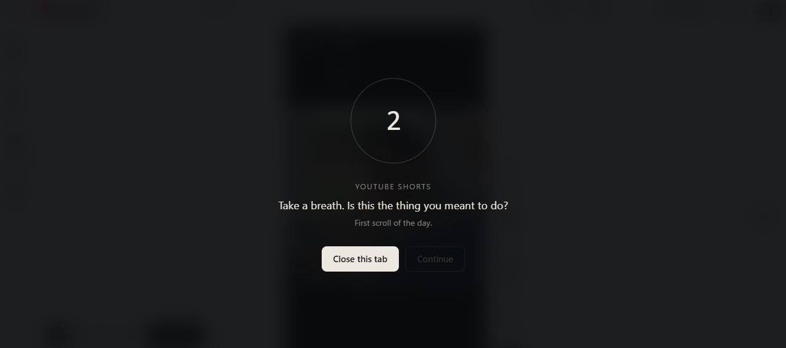
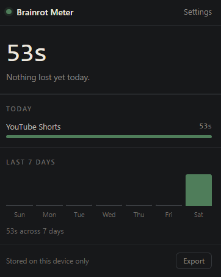
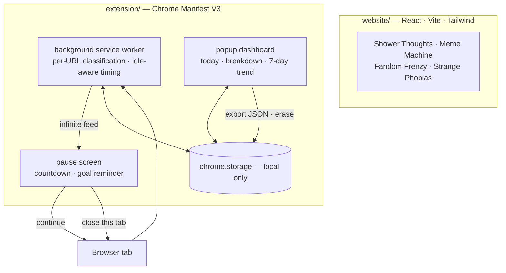
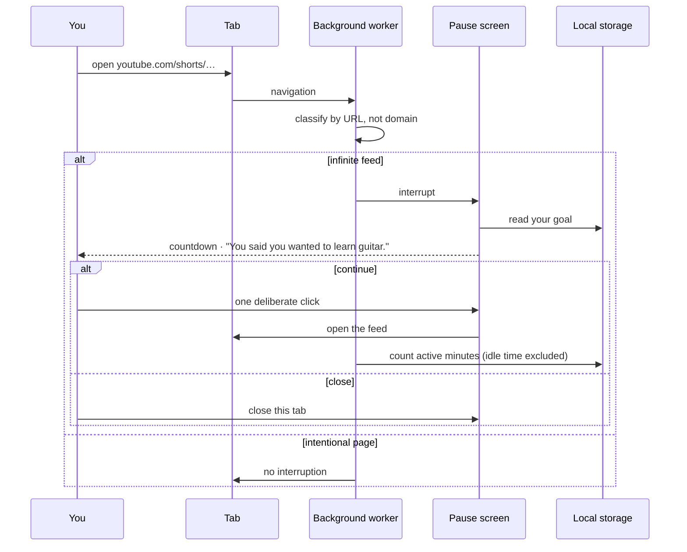

# Rotmeter

<p align="center">
  <a href="Rotmeter%20Demo.mp4">
    
  </a>
  <br>
  <sub>▶ <b><a href="Rotmeter%20Demo.mp4">Watch the Rotmeter demo</a></b> (74 s): the README quick start on a fresh clone, then the site and the extension from the release zip, driven live</sub>
</p>

**The internet, examined — and interrupted. A site about internet-culture brainrot, and a Chrome extension that puts a few deliberate seconds between you and the infinite feed.**

[](https://github.com/guru-bharadwaj20/Rotmeter/releases/latest/download/brainrot-meter.zip)
[](https://github.com/guru-bharadwaj20/Rotmeter/releases)
[](extension/)
[](website/)
[](extension/README.md)
[](LICENSE)

Two halves that argue with each other. One makes the case about attention and
algorithmic capture; the other shows up at 11:40 pm, when the case actually
matters.

<p align="center">
  
  &nbsp;&nbsp;
  
</p>

---

## Contents

| Section | |
|---|---|
| [What it does](#what-it-does) | The site and the extension, by area |
| [Architecture](#architecture) | Two halves, one subject |
| [How a pause works](#how-a-pause-works) | URL in, friction, choice |
| [Quick start](#quick-start) | Install the extension, run the site |
| [Project status](#project-status) | Where it came from, and what ships |
| [Design decisions](#design-decisions) | Why friction, not just tracking |
| [Repository layout](#repository-layout) | Where things live |
| [Documentation](#documentation) | Which file answers which question |
| [Team](#team) | Who built it |

---

## What it does

| Area | Capabilities |
|---|---|
| **The pause** | A short, enforced countdown before an infinite feed opens, one deliberate click to continue, and a one-tap "close this tab" |
| **Classification** | Per-URL, not per-domain: a Short is brainrot, a lecture isn't; r/all is, r/cscareerquestions isn't |
| **Platforms** | YouTube Shorts, Instagram Reels, X / Twitter, Reddit's front page, Facebook, Snapchat Spotlight, Threads, Bluesky, Tumblr, Pinterest, Quora, 9GAG, ShareChat, Likee |
| **Dashboard** | Today's total, a per-platform breakdown, a 7-day trend, and a running time badge on the toolbar icon |
| **Cost framing** | Name what the scrolling is taking from ("learn guitar") and the pause says it back to you |
| **Check-ins** | A gentle reminder after a set number of feed-minutes in a day |
| **Honest numbers** | Idle-aware tracking — time away from the keyboard isn't counted |
| **Privacy** | 100% local storage, no account, no network code; JSON export and one-tap erase |
| **The site** | Deep Shower Thoughts, a live Meme Machine, Fandom Frenzy and Strange Phobias — an essay about attention underneath the humour |

---

## Architecture



There is no server: nothing in the extension makes a network request.

---

## How a pause works



---

## Quick start

**The extension** — no build step:

1. [Download the zip](https://github.com/guru-bharadwaj20/Rotmeter/releases/latest/download/brainrot-meter.zip) and **unzip it**.
2. Open `chrome://extensions` and turn on **Developer mode** (top right).
3. Drag the unzipped **`brainrot-meter` folder** onto the page — or clone the repo
   and use **Load unpacked** on [`extension/`](extension/).

Chrome loads unpacked extensions from a folder, not a `.zip`. Works in Chrome,
Edge, Brave and any other Chromium browser.

**The site**

```bash
cd website
npm install
npm run dev
```

---

## Project status

Rotmeter began as **BrainROT**, a multi-page React site built with teammates as
the final deliverable for the **PESU I/O** course. After the course, the project
continued solo: its own subject — attention, and the way infinite feeds take it —
became a tool, the **Brainrot Meter** extension, built on top of the site.

| Part | Status |
|---|---|
| Site | ✅ the course deliverable, carried forward |
| Extension | ✅ released as a downloadable zip on GitHub Releases |
| Platforms covered | 14 |

---

## Design decisions

**The pause is the product.** Screen-time dashboards have famously poor
retention: people install one, get scolded by a number, and uninstall. The *one
sec* study (PNAS, 2023) found roughly a third fewer app opens from a brief
enforced pause. Interrupting the automatic reach works; informing someone of a
fact they already know doesn't. The dashboard is there to make the pause
credible.

**Friction, not a wall.** A countdown and one deliberate click is enough to break
the reflex without making the extension something you fight and remove.

**Personal, forward-looking cost.** "You said you wanted to learn guitar" has far
more teeth than "41 hours = 12 books".

**Per-URL classification.** Blocking a domain punishes the intentional uses of a
platform; classifying the URL targets only the endless surfaces.

**Local only.** No account, no server, no network code. Your data never leaves
the machine, and you can export or erase it in one tap.

---

## Repository layout

```
.
├── website/              React + Vite site — the essay
├── extension/            Chrome extension, Manifest V3 — the intervention
├── images/               screenshots used in this README
└── brainrot-meter.zip    the packaged extension
```

---

## Documentation

| Question | File |
|---|---|
| *How is the extension built?* | [extension/README.md](extension/README.md) |

> Built for educational and portfolio purposes. Memes, fandom references, images
> and text on the site are used under fair-use guidelines; trademarks and
> copyrights belong to their owners. The extension collects nothing and sends
> nothing.

---

## Team

| Member | Focus |
|---|---|
| **Guru R Bharadwaj** | The Brainrot Meter extension, and the site with PESU I/O teammates |

---

## License

[MIT](LICENSE).
